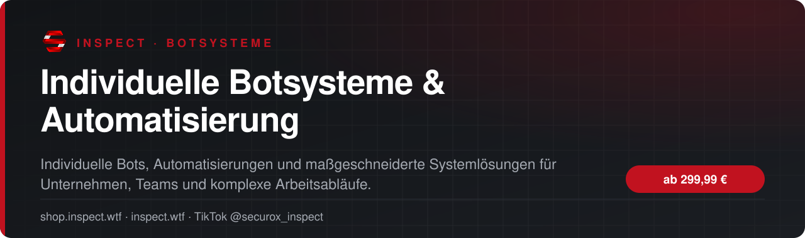
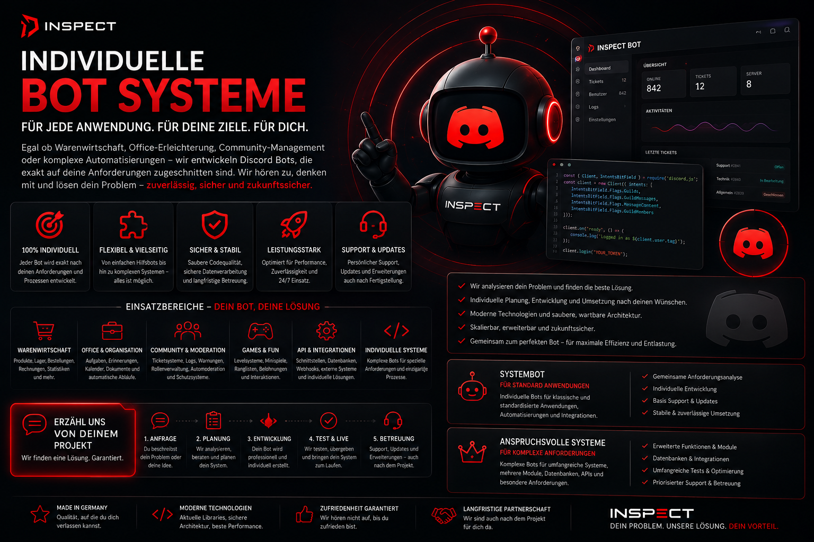

<!-- inspect-showcase: automatisch erzeugt, Änderungen bitte im Shop vornehmen -->

  
  
  

  
  
  

 

> 🇬🇧 **English:** Individuelle Botsysteme & Automatisierung – custom Discord bots and automation (service) by SecuroX Inspect. Purchase and licensing exclusively at [shop.inspect.wtf](https://shop.inspect.wtf). Product details below are in German – questions are welcome on [Discord](https://discord.gg/inspect).

 

## Das Wichtigste auf einen Blick

<table>
  <tr>
    <td width="50%" valign="top">✔&nbsp; <b>Individuelle Entwicklung statt starrer Standardlösung</b></td>
    <td width="50%" valign="top">✔&nbsp; <b>Automatisierung wiederkehrender Arbeitsabläufe</b></td>
  </tr>
  <tr>
    <td width="50%" valign="top">✔&nbsp; <b>Lösungen für Warenwirtschaft, Verwaltung und interne Prozesse</b></td>
    <td width="50%" valign="top">✔&nbsp; <b>Office-Erleichterungen und digitale Assistenzsysteme</b></td>
  </tr>
</table>

## Überblick

Nicht jedes Problem lässt sich mit einer Standardsoftware lösen. Genau dort setzen wir an. Wir entwickeln individuelle Botsysteme, Automatisierungen und digitale Helfer, die sich an deinen tatsächlichen Arbeitsabläufen orientieren. Ob Warenwirtschaft, interne Verwaltung, Office-Erleichterung, Datenverarbeitung, Schnittstellen, Benachrichtigungen, wiederkehrende Aufgaben oder anspruchsvolle Sonderlösungen – wir analysieren den Anwendungsfall und entwickeln eine Lösung, die Arbeit abnimmt, Prozesse beschleunigt und Fehler reduziert. Vor Projektbeginn werden Anforderungen, gewünschte Funktionen, Schnittstellen und der konkrete Leistungsumfang gemeinsam abgestimmt.

## Alle weiteren Funktionen

- Datenverarbeitung, Auswertungen und Benachrichtigungen
- API-, Datenbank- und Schnittstellenanbindungen
- Webhooks, externe Dienste und bestehende Systeme integrierbar
- Rollen-, Rechte- und Freigabelogiken nach Bedarf
- Geeignet für kleine und mittelständige Unternehmen, Teams und individuelle Projekte
- Anforderungen und Leistungsumfang werden vor Entwicklungsbeginn gemeinsam festgelegt
- Zusätzliche Module, Hosting, externe Dienste und Sonderintegrationen werden bei Bedarf separat vereinbart

## Preis

| Paket | Leistungsumfang | Preis |
|:--|:--|--:|
| **Systembot** | Für klar definierte Automatisierungen und interne Abläufe, zum Beispiel Benachrichtigungen, Datensynchronisation, Office-Erleichterungen, Verwaltungsaufgaben oder einfache Schnittstellen. | **299,99 €** |
| **Anspruchsvolle Systeme** | Für komplexere Automatisierungen, mehrere Module, Datenbanken, APIs, umfangreiche Logiken, externe Systeme und individuell entwickelte Prozesslösungen. | **499,99 €** |

Sichere Zahlung mit PayPal oder Kreditkarte · Rechnung als PDF · Support auf Deutsch

## So läuft die Beauftragung ab

1. **Im Shop buchen** – sicher bezahlen mit PayPal oder Kreditkarte.
2. **Persönliche Abstimmung** – wir klären Umfang, Wünsche und Ablauf direkt mit dir.
3. **Umsetzung & Übergabe** – mit festem Ansprechpartner über Discord.

## Warum INSPECT?

<table>
  <tr>
    <td width="50%" valign="top"><b>🇩🇪 Entwickelt in Deutschland</b> Konzeption, Entwicklung und Support aus einer Hand.</td>
    <td width="50%" valign="top"><b>💬 Persönlicher Support</b> Schnelle Hilfe auf Deutsch im INSPECT Discord.</td>
  </tr>
  <tr>
    <td width="50%" valign="top"><b>🔒 Sichere Zahlung</b> PayPal oder Kreditkarte, Rechnung automatisch als PDF.</td>
    <td width="50%" valign="top"><b>🤝 Individuelle Abstimmung</b> Leistungsumfang wird vor Beginn gemeinsam festgelegt.</td>
  </tr>
</table>

## Häufige Fragen

<b>Wie läuft die Beauftragung ab?</b>

 

Nach der Buchung im Shop melden wir uns bei dir und stimmen Umfang, Inhalte und Zeitplan gemeinsam ab.

<b>Kann ich vorher Fragen stellen?</b>

 

Ja – schreib uns einfach im [INSPECT Discord](https://discord.gg/inspect) oder per E-Mail an [info@inspect.wtf](mailto:info@inspect.wtf).

<b>Wo kaufe ich offiziell?</b>

 

Ausschließlich im INSPECT Shop unter [shop.inspect.wtf](https://shop.inspect.wtf). Angebote von Dritten stammen nicht von uns.

## Kontakt

| | |
|:--|:--|
| 🛒 Shop | [shop.inspect.wtf](https://shop.inspect.wtf) |
| 🌐 Website | [inspect.wtf](https://inspect.wtf) |
| 💬 Discord | [discord.gg/inspect](https://discord.gg/inspect) |
| 🎬 TikTok | [@securox_inspect](https://www.tiktok.com/@securox_inspect) |
| ✉️ E-Mail | [info@inspect.wtf](mailto:info@inspect.wtf) |

---

<b>SecuroX Inspect</b> · Offizielle Produktpräsentation · Dieses Repository enthält keinen Quellcode und keine Produktdateien. 
Kauf und Lizenzen ausschließlich über <a href="https://shop.inspect.wtf">shop.inspect.wtf</a> · Inhalte werden automatisch aus dem Shop aktualisiert.

